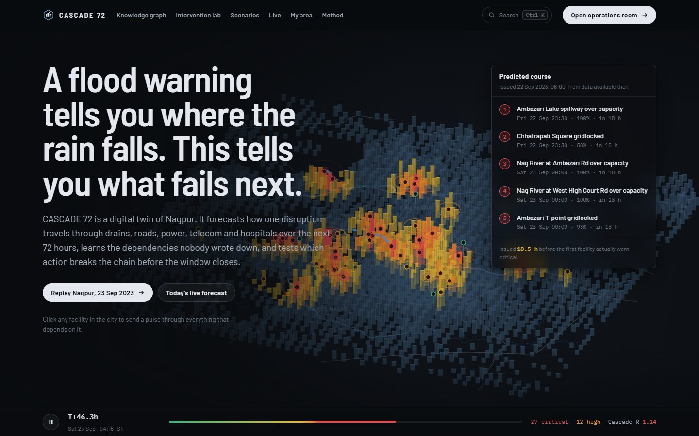
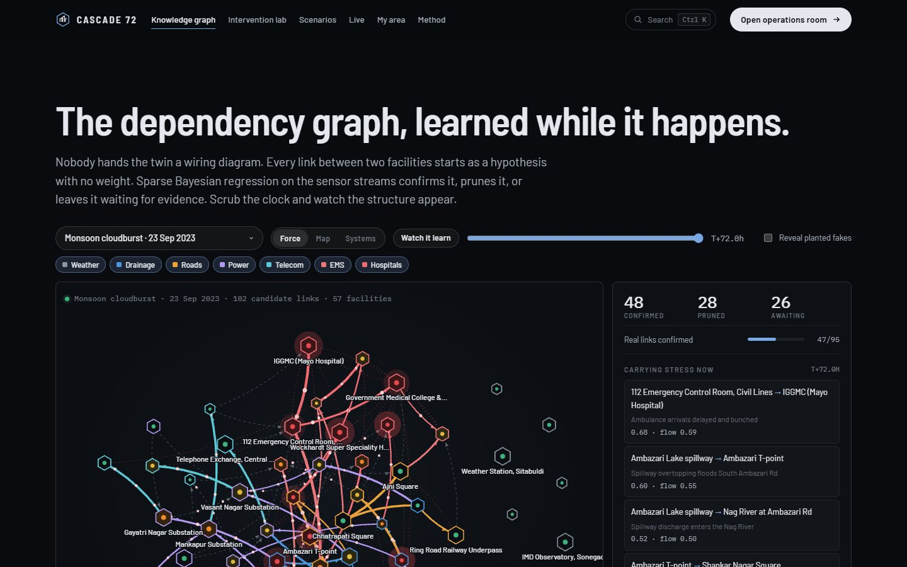
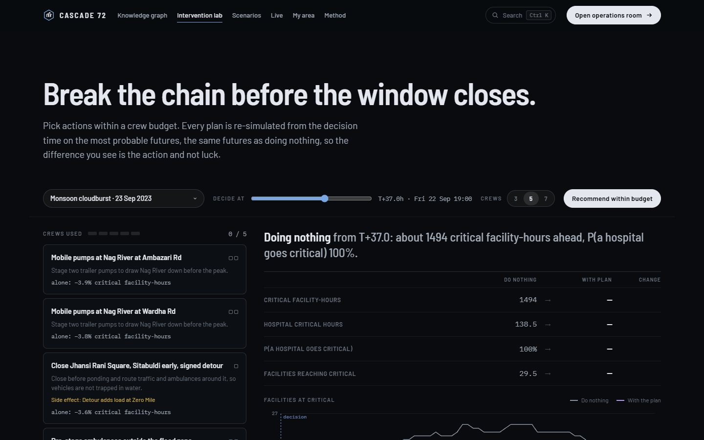
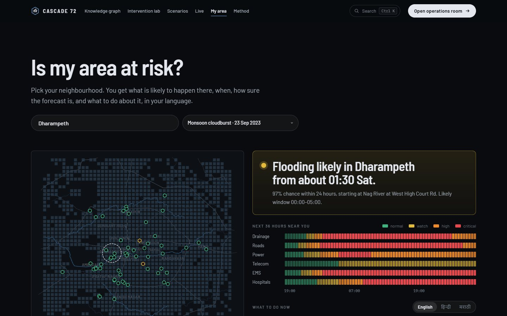

# CASCADE 72 · The 72-hour warning for cities

**A digital twin of Nagpur that forecasts how an urban crisis cascades through drains, roads,
power, telecom, emergency response and hospitals up to 72 hours ahead.** It learns the
dependencies nobody wrote down, explains every prediction, tests which actions break the chain
before the window closes, survives attacks on its own data, and writes the warnings in English,
Hindi and Marathi. Raleigh, North Carolina ships as the unseen-city test.

Built for **CASCADE '26** (IIIT Nagpur, TantraFiesta) · Theme 2 · Problem 2 · *The 72-Hour Warning*.
Everything runs in the browser: static files, no build step, no server-side compute, offline
except for live weather.

| Home: the 2023 cloudburst, replayed | Knowledge graph, learned live |
| --- | --- |
|  |  |
| **Intervention lab** | **My area, for residents** |
|  |  |
| **Operations room: crisis registry and footprints** | **Operations room: red-team console** |
|  |  |
| **Decision deadline and ghost city** | **Public alerts in English, Hindi and Marathi** |
|  |  |

---

## Quick start

```bash
git clone https://github.com/vizsh/72_hours_CASCADE.git
cd 72_hours_CASCADE
python tools/serve.py            # → http://localhost:8000
```

| Open | What you get |
| --- | --- |
| http://localhost:8000 | the website (start here) |
| http://localhost:8000/twin.html | the operations room, Nagpur |
| http://localhost:8000/twin.html?scenario=chlorine | a specific scenario |
| http://localhost:8000/twin.html?city=raleigh | the unseen city |
| http://localhost:8000/citizen.html?area=Dharampeth | the resident view for one neighbourhood |

No install is needed beyond Python 3 (for the server). Any static server works. Press **Ctrl K**
on any website page to jump to a page, a scenario replay or any of Nagpur's 57 facilities.

## At a glance

| | |
| --- | --- |
| **Cities** | Nagpur, Maharashtra (default) · Raleigh, NC (unseen-city test) |
| **Scenarios** | **Nagpur: 8** (monsoon cloudburst 2023, chlorine release, festival crowds + storm, grid and telecom blackout, tropical rain, flash flood, heat wave, live GFS weather) · **Raleigh: 5** (tropical, flash, heat, blackout, live) |
| **Nagpur facilities** | **57**: 13 drainage (Nag, Pili and Pohara river gauges, Ambazari and Gorewada lake spillways, Gandhi Sagar pumps), 13 junctions, 9 substations, 5 telecom, 4 EMS (incl. the 112 control room), 6 hospitals (GMC, Mayo, Wockhardt …), 7 weather |
| **Dependencies** | 102 candidate links in Nagpur (7 planted fakes), learned online; 71 in Raleigh |
| **People** | 2,935,456 modeled Nagpur residents on 1,790 cells of 450 m |
| **Forecast** | 200-member ensemble · 145 half-hour steps · localized particle filter with forgetting and tempering |
| **Monsoon 2023 replay** | warned **18.5 h** before the first facility went critical · median lead **22.5 h** · **85%** of critical events warned · **0** false alarms · Brier skill **+0.81** |
| **Interfaces** | operations room (3D twin) + 7 website pages + CAP 1.2 / SITREP / SMS outputs |

## Documentation

Start with the overview, then go as deep as you need. Everything in the repository is described
somewhere below.

| # | Document | What it covers |
| --- | --- | --- |
| 1 | [Overview and approach](docs/01-overview.md) | the problem, users, design principles, a requirement-by-requirement map of the brief to features, code and UI |
| 2 | [Architecture](docs/02-architecture.md) | stack, runtime architecture, the worker RPC, a file-by-file repository map, the geodata model, rendering, performance |
| 3 | [The cascade engine](docs/03-engine.md) | simulation equations and constants, ensemble, observations and faults, particle filter, sensor trust, ARD learning, forecasts, explanations, alerts, corroboration, city state, validation |
| 4 | [Scenarios](docs/04-scenarios.md) | **all 8 scenarios** with truth and prior parameters, what cascades, highlights, planted faults and reports, how to add one |
| 5 | [The operations room](docs/05-operations-room.md) | every control of `twin.html`: top bar, layers, assets, alerts, map, inspector, timeline, six drawers, URL parameters, keyboard |
| 6 | [The operations layer](docs/06-operations-layer.md) | Cascade-R, the crisis registry algorithm, interventions (catalogue generator, evaluation, deadlines, ghost city), red team, SITREP / CAP / SMS, people at risk |
| 7 | [The website](docs/07-website.md) | all eight pages in detail: home hero and poke, knowledge graph, lab, scenarios, live, My area, method |
| 8 | [User flows](docs/08-user-flows.md) | eleven step-by-step journeys: demo, duty officer, planner, analyst, comms, red team, resident, meteorologist, comparisons, learning, adding a city |
| 9 | [Development](docs/09-development.md) | running, configuration, the data pipeline, the spec format, adding a city, single-file build, tests, conventions, troubleshooting |
| 10 | [Glossary, FAQ and limits](docs/10-glossary-faq.md) | every term, common questions, honest limits, credits |
| R | [Reference: Nagpur](docs/reference/nagpur.md) | *generated*: every facility (coordinates, sensor, tier, parameters, population), all 102 links (mechanism, lag, route, hidden weight), districts, population grid, faults, false reports |
| R | [Reference: Raleigh](docs/reference/raleigh.md) | *generated*: the same for Raleigh |
| R | [Reference: results](docs/reference/results.md) | *generated*: scorecard and cascade shape for every city × scenario; crises at "now" and at the peak; action catalogues with single-action gains; recommended plans, deadlines and side effects; red-team outcomes per attack |
| R | [Reference: messages](docs/reference/messages.md) | *generated*: per-city language config, CAP vocabulary, every message template in English, Hindi, Marathi and Spanish, and a real SMS set, CAP XML and SITREP |
| — | [Roadmap and status](docs/ROADMAP.md) | the original gap analysis and what was built |

The reference documents are produced by `node tools/gen_docs.js` from the code and engine runs, so
their numbers always match the repository.

## What it does

**Forecasting**
- 72 h forecasts with NORMAL / WATCH / HIGH RISK / CRITICAL per facility and city-wide, from a
  200-member ensemble assimilated every 30 minutes.
- Multi-horizon fan charts (+1 to +48 h) and P(critical within 24 h).
- Time to critical with p10–p90.

**Learning**
- No wiring diagram is given. 102 candidate links are confirmed, pruned or left waiting by sparse
  Bayesian regression (ARD) on the sensor streams.
- A model-free raw-stream screen checks the structure at system level.
- Seven planted fakes test the learner.

**Robustness**
- Sensor trust from residuals, flatline detection, a rain-gauge buddy check and a physical step
  test.
- Quarantined feeds are forgotten fast.
- Citizen reports are scored against the severity they claim.

**Explanation**
- Every risk splits into baseline, hazard and each upstream link (weight ± sd, lag, mechanism,
  upstream reading and trust).

**Cascade intelligence**
- **Cascade-R:** is the cascade feeding itself? Shown now and forecast, with the predicted crossing
  time.
- **Crisis registry:** concurrent crises with IDs, hazard type, stage, map footprint, residents,
  systems, coupling and contention.

**Decisions**
- An action catalogue generated from each city's graph, tested on identical futures, with a greedy
  plan under a crew budget.
- Side effects, decision deadlines ("act by T+47"), and a ghost city that repaints the twin with the
  plan.

**Adversity**
- A red-team console with five attacks, each rebuilt on poisoned streams and scored against the
  clean run.

**Warnings**
- SITREP, CAP 1.2 (one info block per language, footprint polygon), and SMS in English, Hindi and
  Marathi with GSM-7 / UCS-2 segment counts.

**Live**
- Today's 31-member GFS ensemble (Open-Meteo) becomes the hazard prior for the twin.

**Validation**
- Replays scored against a hidden truth with strict future-data isolation: Brier, skill,
  reliability, lead time, detection, false alarms.

**Generalisation**
- Raleigh runs the same code with nothing retuned.

## Scenarios

| ID | Scenario | Cities | What happens |
| --- | --- | --- | --- |
| `monsoon2023` | Monsoon cloudburst · 23 Sep 2023 | Nagpur | Reconstruction of the pre-dawn cloudburst (~106 mm in 4 h); Ambazari Lake overflows into the Nag; floods, gridlock, EMS delays, hospital load |
| `chlorine` | Chlorine release at a water treatment plant | Nagpur | Gaussian plume from Seminary Hills WTP on a 330° wind; closures load ambulance routes; exposure surge at hospitals |
| `festival` | Immersion-day crowds meet an evening storm | Nagpur | Processions at Gandhi Sagar and Futala plus a thunderstorm: a crowd crisis and a flood crisis at once |
| `blackout` | Grid fault and telecom blackout | Nagpur, Raleigh | Substation cluster drops; mobile sites drain their batteries; dispatch and hospitals follow |
| `tropical` | Tropical remnant rainfall | Nagpur, Raleigh | Two rain bands on saturated soils |
| `flash` | Convective flash flood | Nagpur, Raleigh | Training thunderstorms stall over one basin |
| `heat` | Heat wave and grid stress | Nagpur, Raleigh | Three-day heat dome with a derecho on day two |
| `live` | Live weather · GFS ensemble | Nagpur, Raleigh | Today's real forecast, 31 members mapped onto 200 particles |

Parameters and results: [Scenarios](docs/04-scenarios.md) · [results](docs/reference/results.md).

## Replay validation

Warning rule: P(critical within 24 h) ≥ 60%. Synthetic ground truth: these numbers show the
pipeline works and is isolated from the future; they are not proof of real-world skill.

| City | Scenario | Median lead | Detection | False alarms | Brier | Skill |
| --- | --- | --- | --- | --- | --- | --- |
| Nagpur | Monsoon cloudburst 2023 | 22.5 h | 85% | 0% | 0.040 | +0.81 |
| Nagpur | Tropical rainfall | 20.5 h | 96% | 13% | 0.060 | +0.74 |
| Nagpur | Flash flood | 16.0 h | 75% | 0% | 0.079 | +0.67 |
| Nagpur | Heat wave | 18.5 h | 94% | 0% | 0.023 | +0.80 |
| Nagpur | Grid and telecom blackout | 21.5 h | 50% | 0% | 0.017 | +0.68 |
| Raleigh | Tropical rainfall | 19.0 h | 82% | 25% | 0.076 | +0.59 |
| Raleigh | Flash flood | 16.5 h | 77% | 5% | 0.070 | +0.63 |
| Raleigh | Heat wave | 23.0 h | 77% | 0% | 0.019 | +0.81 |
| Raleigh | Grid and telecom blackout | 16.5 h | 88% | 11% | 0.017 | +0.77 |

The chlorine and festival scenarios have too few critical events for a stable score. Full tables:
[reference/results.md](docs/reference/results.md).

## The website

| Page | What it does |
| --- | --- |
| [`index.html`](index.html) | The 2023 cloudburst as a city of light. **Click any facility to send a pulse through its dependencies.** It shows the course predicted 18.5 h ahead, six live capability demos, scenarios and the scorecard. |
| [`graph.html`](graph.html) | The learned dependency graph: drag, zoom, three layouts, **Watch it learn**, reveal planted fakes, live drivers per facility |
| [`lab.html`](lab.html) | Plan actions under a crew budget: outcome vs doing nothing, per-system impact, side effects, decision deadline, hand-off to the ghost city |
| [`scenarios.html`](scenarios.html) | Hazard × system reach matrix and a dossier per scenario; Raleigh as the unseen city |
| [`live.html`](live.html) | Today's 31-member GFS ensemble for any city; hand-off to the live twin |
| [`citizen.html`](citizen.html) | "Is my area at risk?": verdict, 36 h ribbon, what to do in three languages, nearest hospital, roads to avoid |
| [`method.html`](method.html) | Interactive explainers: particle filter, link learning, sensor trust, Cascade-R, lead times |
| [`twin.html`](twin.html) | The operations room |

## Repository

```
index.html … method.html, twin.html     website pages and the operations room
config.js                               runtime configuration
data/tiles, data/fonts                  OpenMapTiles vector tiles and glyphs (offline)
src/css/                                design tokens and styles (twin + website)
src/js/core.js                          shared vocabulary and helpers
src/js/data/                            generated geodata (Nagpur, Raleigh)
src/js/engine/                          scenarios, engine, interventions, analytics, comms, redteam, live
src/js/map/                             MapLibre layers, markers, radar, bootstrap
src/js/ui/                              operations-room panels, drawers, orchestrator
src/js/site/                            website: worker RPC, chrome, city canvas, page scripts
tools/                                  dev server, data pipeline, single-file build, doc generator, tests
docs/                                   this documentation, screenshots, generated references
```

File-by-file: [Architecture § Repository map](docs/02-architecture.md#repository-map).

## Honest about what is real

| Real | Simulated and labelled |
| --- | --- |
| Streets, rivers, lakes, buildings, substations, hospitals, fire stations, junctions (OpenStreetMap) | sensor readings, bed counts, feeder loads, ambulance times |
| Storm timing and totals for the 2023 replay (IMD-reported) | link weights in the hidden world; planted faults and false reports |
| Live 31-member weather ensembles (Open-Meteo GFS) | population distribution (scaled to city totals) |

## Tests

```bash
node tools/test/qc_regress.js                       # skill and sensor flags, every city × scenario
node tools/test/ops_probe.js nagpur monsoon2023 47  # Cascade-R, crises, comms, planner, red team
node tools/gen_docs.js                              # regenerate docs/reference/*.md
```

More in [Development § Tests](docs/09-development.md#tests-and-probes).

## Credits

Map data © OpenStreetMap contributors (ODbL) · tiles © OpenMapTiles, served by OpenFreeMap ·
weather ensemble © Open-Meteo (CC BY 4.0), GFS by NOAA · rendering by MapLibre GL JS (BSD-3) ·
fonts Barlow, IBM Plex Mono, Noto Sans Devanagari (SIL OFL). The base UI was imported from
[shreyascoder2006/72_UI](https://github.com/shreyascoder2006/72_UI) and extended. Decision support
only: it proposes, people decide.
