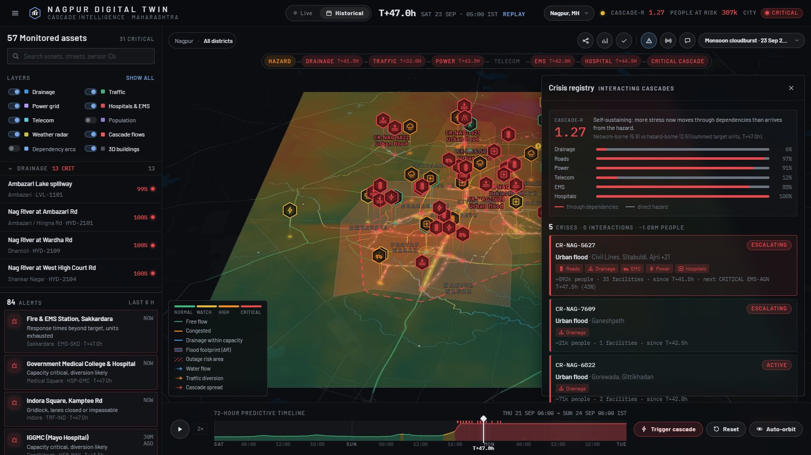
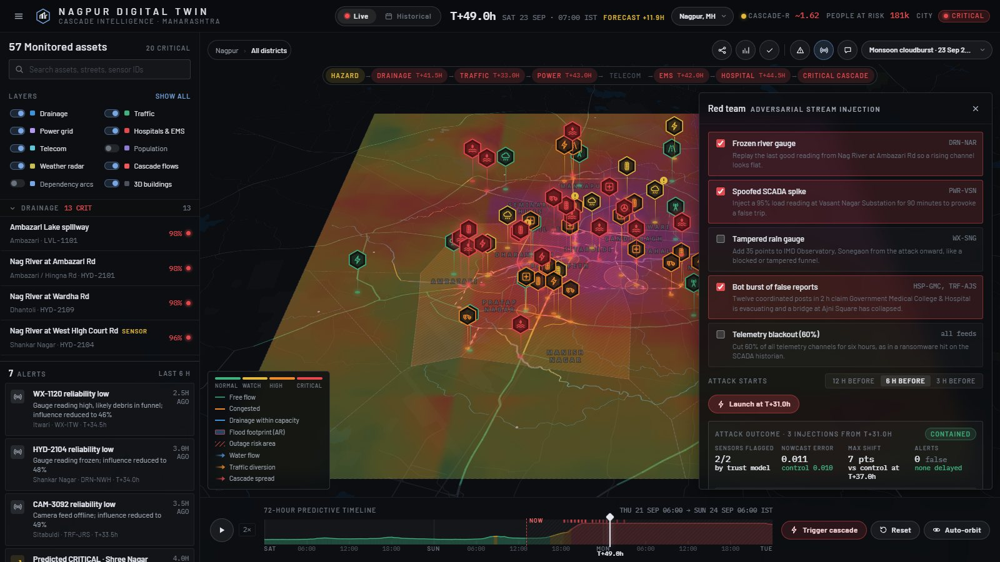
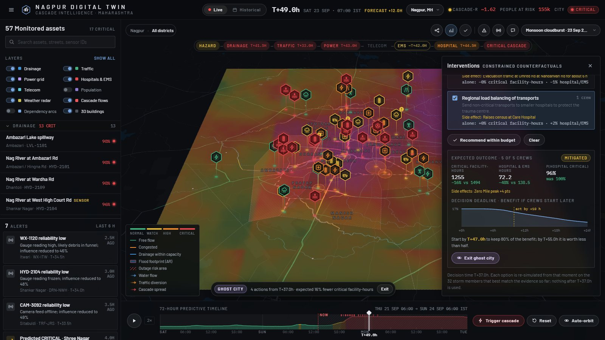
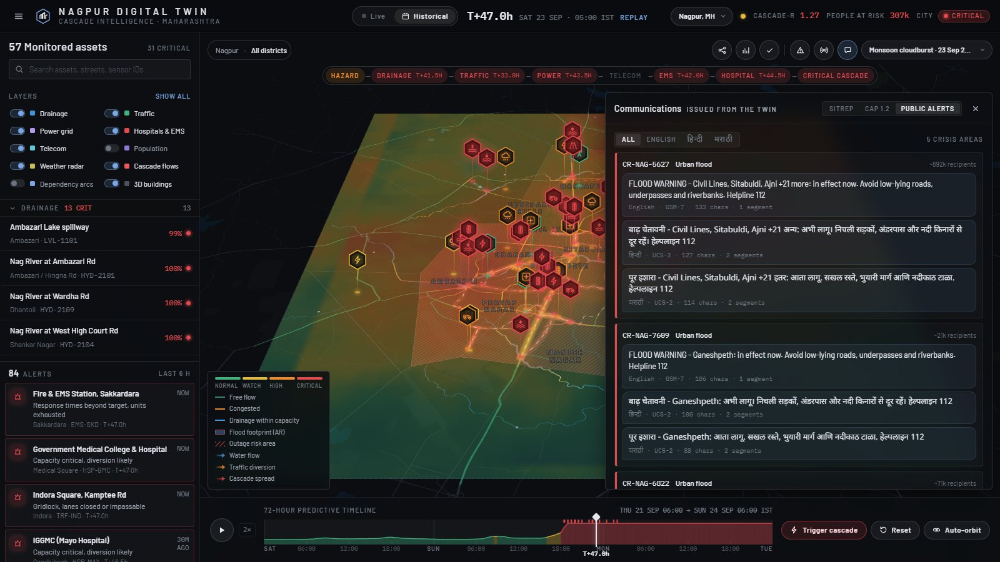

# CASCADE 72 · Urban Digital Twin

A 3D digital twin of **Nagpur, Maharashtra** that predicts how an urban crisis cascades through
drainage, roads, power, telecom, emergency response and hospitals up to 72 hours ahead. It
identifies the crises taking shape, explains every forecast, plans constrained interventions,
withstands attacks on its own data, and issues the warnings. **Raleigh, NC** ships as the
unseen-city test: the same engine runs on it unchanged.

Built for CASCADE '26 (IIIT Nagpur), Theme 2 · Problem 2, *The 72-Hour Warning*. The city model
is real: OpenStreetMap buildings, streets, rivers, substations, hospitals and junctions. The
cascade intelligence is an analytical layer on top of it, the way production CIM and digital-twin
platforms are structured.

| Crisis registry and footprints | Red-team console |
| --- | --- |
|  |  |
| **Decision deadline and ghost city** | **Public alerts in English, Hindi and Marathi** |
|  |  |

## Run it

```bash
python3 -m http.server 8000      # from the repository root
# open http://localhost:8000              Nagpur (default)
# open http://localhost:8000/?city=raleigh   the unseen-city test
```

Any static file server works. Everything runs in the browser, offline: tiles, glyphs, the
200-member ensemble and the assimilation all ship with the page. The one online feature is
**Live weather**, which fetches the Open-Meteo GFS ensemble when you pick it from the scenario menu.

`python3 tools/build_dist.py` writes `dist/index.html`. That is a single page with all CSS,
JavaScript and both cities inlined, plus the tiles packed as base64 bundles for hosts that only
serve text. It runs under a strict Content-Security-Policy.

## Where to look

| Control | What it shows |
| --- | --- |
| Top bar | City state, **people at risk** (residents whose nearest facility is HIGH RISK or worse) and **Cascade-R**. Cascade-R turns into a forecast (`~`) when you scrub ahead. |
| Timeline | Drag to scrub through 72 h. In Live mode, right of NOW is forecast. **Historical** replays with strict future-data isolation. **Trigger cascade** streams the sensors from T+0. |
| Dependency graph | Links learned online from the streams: confirmed, pruned or awaiting evidence, numbered in propagation order. |
| Interventions | Constrained counterfactuals with crew costs and side effects. Shows a **decision deadline** curve and a **ghost-city** toggle that repaints the twin with the plan applied. |
| Validation | Brier score, reliability, detection, false alarms and lead time against the hidden truth. |
| **Crises** | Concurrent crises, each with an ID, type, stage, footprint on the map, people exposed and systems reached; a crisis × system matrix; coupling and contention between crises. |
| **Red team** | Attacks the twin's own inputs live, then scores how it coped against a clean control run. |
| **Comms** | SITREP, a CAP 1.2 alert, and public SMS / cell-broadcast text, all generated from the twin at the issue time. |

## Cities and hazards

Each crisis keeps its own identity. The links between crises, and between each crisis and the
systems it reaches, are modeled rather than collapsed into one index.

| Scenario | Cities | Hazard and cascade |
| --- | --- | --- |
| Monsoon cloudburst · 23 Sep 2023 | Nagpur | Reconstruction of the pre-dawn cloudburst (about 106 mm in four hours, Ambazari Lake overflowing into the Nag). Timing and totals follow IMD-reported figures; city telemetry is modeled. |
| Chlorine release | Nagpur | Cylinder failure at the Seminary Hills water treatment plant. Gaussian plume (Briggs class C) on the wind axis; closures load the roads ambulances need. |
| Immersion-day crowds meet a storm | Nagpur | Processions converge on Gandhi Sagar and Futala while a thunderstorm builds. A crowd crisis and a flood crisis run concurrently. |
| Grid fault and telecom blackout | any | A transmission fault drops a substation cluster. Mobile sites run down their batteries, calls stop reaching dispatch, hospitals burn diesel. |
| Tropical rainfall, flash flood, heat wave + derecho | any | Weather-driven cascades through drainage, roads, power and care. |
| **Live weather · GFS ensemble** | any | The 31 GFS members fetched for the city become the hazard prior. You get 24 h of history and 48 h of forecast. |

| | Nagpur | Raleigh (unseen city) |
| --- | --- | --- |
| Monitored facilities | 57 (13 drainage incl. a pumping station, 13 junctions, 9 substations, 5 telecom, 4 EMS, 6 hospitals, 7 weather) | 44 (no telecom: the generic engine adapts) |
| Candidate links | 102, of which 7 are deliberately spurious | 71, of which 7 are deliberately spurious |
| Modeled population | 2.94 M on 450 m cells, from street, building and water density | 0.45 M |
| Languages for alerts | English, Hindi, Marathi (helpline 112, ambulance 108) | English, Spanish (911) |

## How the intelligence layer meets the brief

| Requirement | Implementation |
| --- | --- |
| **Multi-horizon forecasting** | 200-member ensemble. Each facility gets P(critical) and a fan chart at +1/6/12/24/48 h, plus time-to-critical with p10–p90. |
| **Dependency discovery** | No structure is given. Candidate links are learned online by sparse Bayesian regression (ARD) and end up confirmed, pruned or still awaiting evidence. A raw-stream screen (lagged correlation, with weather partialled out) checks the structure at system level. |
| **Cascade prediction** | Lagged propagation with feedback loops (hospital → EMS → hospital, load transfer between substations), branching, and interacting crises. **Cascade-R** compares stress arriving through dependencies with stress arriving straight from the hazard. In the monsoon replay it goes from 0 to 1.05 at T+46, when the cascade becomes self-sustaining. Forecast from T+37, it predicts the same crossing. |
| **Crisis identification** | Crises are connected components of stressed facilities, joined where stress flows along a learned link now or is forecast to. Each gets a type from the scenario's hazard priority (a flood that jams roads is still a flood), a stage (precursor, emerging, escalating, active, recovering) and a footprint. Separate river systems come out as separate crises (the Nag vs the Pili). |
| **Online learning under drift** | Localized particle filter with forgetting (about a 23 h memory) and adaptive tempering, which keeps the effective sample size at or above 12%. |
| **Uncertainty and adversity** | Sensor trust comes from four signals: spread-normalized residuals, flatline detection, a **buddy check** across rain gauges and a physical **step test** (no facility can move faster than its response rate). Citizen reports are scored against the severity they claim. Every trusted value carries a spread. |
| **Causal explainability** | Every risk value decomposes into baseline, hazard and each upstream link (posterior weight ± sd, lag, mechanism, upstream reading and its trust). |
| **Constrained counterfactuals** | The action catalogue is generated from each city's dependency graph: pumps, early closures with signed detours, ambulance staging, mobile generation, flood barriers, telecom fuel, evacuation, load balancing. Each action is re-simulated from the decision time on the most probable members. A greedy planner chooses within the crew budget. **Decision deadlines** re-run the plan with later starts: on the monsoon run, starting by T+47 keeps 80% of the benefit, while the chlorine release has to be acted on at once. |
| **Generalization** | Raleigh runs on the same engine, catalogue generator and analytics without retuning. |
| **Temporal validation** | Historical mode replays the window. Every forecast uses only data up to its time stamp and is scored against the hidden truth. |

### Red team

The console attacks the observation stream: a frozen river gauge, a spoofed SCADA spike, a
tampered rain gauge, a burst of 12 coordinated bot reports, and a 60% telemetry blackout. The
attacked twin is rebuilt from scratch on the poisoned streams and scored against the clean run.
On the Nagpur monsoon:

- **Spoofed spike from a calm state.** The step test catches it on the first reading: the raw feed says 95%, the twin moves from 35% to 47%.
- **Frozen gauge during the rise.** Flagged after 3.5 h. The twin holds 100% (the truth) while the raw feed still says 44%.
- **Spike near a plausible level.** Not flagged, because it can't be told from a real rise. The console says so instead of hiding it.
- **Bot reports.** Claims of collapse in places the twin shows as NORMAL score about 6% corroboration and are held. Reports never drive the forecast directly.

### Replay validation

Warning rule: P(critical within 24 h) ≥ 60%.

| City | Scenario | Brier | Skill vs climatology | Detection | False alarms | Median lead |
| --- | --- | --- | --- | --- | --- | --- |
| Nagpur | Monsoon cloudburst 2023 | 0.040 | +0.81 | 85% | 0% | 22.5 h |
| Nagpur | Tropical rainfall | 0.060 | +0.74 | 96% | 13% | 20.5 h |
| Nagpur | Flash flood | 0.079 | +0.67 | 75% | 0% | 16.0 h |
| Nagpur | Heat wave | 0.023 | +0.80 | 94% | 0% | 18.5 h |
| Nagpur | Grid fault and telecom blackout | 0.017 | +0.68 | 50% | 0% | 21.5 h |
| Raleigh | Tropical rainfall | 0.076 | +0.59 | 82% | 25% | 19.0 h |
| Raleigh | Flash flood | 0.070 | +0.63 | 77% | 5% | 16.5 h |
| Raleigh | Heat wave | 0.019 | +0.81 | 77% | 0% | 23.0 h |

These numbers come from a synthetic ground truth generated by the same family of models. They
show that the pipeline works end to end and is honestly isolated from future data. They are not
evidence of real-world skill. The festival and chlorine scenarios have too few critical events
for a stable score.

## Communications

- **SITREP.** A plain-text situation report with these sections: situation, active crises and their interactions, forecast of the next CRITICAL crossings, worst facility per system, information integrity (quarantined feeds, corroborated vs held reports), recommended actions with the decision deadline, and next report. Copy or download it.
- **CAP 1.2.** An OASIS Common Alerting Protocol alert per crisis. It has one `<info>` block per language and severity, urgency and certainty derived from the forecast. The area polygon is the crisis footprint. It also carries `CrisisID`, `Stage`, `PeopleExposed` and `CascadeR` parameters. Status is `Exercise` because the streams are replayed.
- **Public alerts.** SMS / cell-broadcast text per crisis area from reviewed templates per hazard type. A segment counter knows that Devanagari forces UCS-2 (70 characters per segment).

## What is real and what is modeled

| Real (OpenStreetMap, ODbL; public records) | Modeled for the simulation |
| --- | --- |
| Buildings, streets, rivers, lakes and parks: OpenMapTiles vector tiles for both cities | Hazard scenarios and the hidden "ground truth" run |
| Nagpur: Nag, Pili and Pohara crossings; Ambazari and Gorewada spillways; Mankapur, Besa, Pardi, Uppalwadi and Hingna substations; GMC, Mayo, Wockhardt, Care and Orange City hospitals; Chhatrapati, Ajni, Jhansi Rani, Zero Mile and other squares | Risk indices, capacities, sensor IDs and readings |
| Substation service areas (Voronoi), dependency routes by Dijkstra on the real street and waterway graphs | Dependency weights in the ground-truth run; injected faults and false reports |
| Live mode: the GFS ensemble from Open-Meteo | Population distribution (scaled to census totals) |

## Layout

```
index.html, config.js      page shell and runtime configuration (?city= selects the geodata)
src/css/                   tokens, layout, panels, map chrome, operations layer
src/js/core.js             risk vocabulary, seeded RNG, geo helpers, time zones
src/js/engine/
  scenarios.js             hazards: rain, heat, grid fault, plume, crowds
  engine.js                ensemble, assimilation, trust QC, dependency learning, alerts, validation
  interventions.js         graph-generated catalogue, counterfactuals, planner, deadlines, ghost trajectories
  analytics.js             Cascade-R (nowcast and forecast) and the crisis registry
  comms.js                 SITREP, CAP 1.2, multilingual SMS
  redteam.js               attack scripts and scoring against the clean control
  live.js                  Open-Meteo GFS ensemble → live scenario
src/js/map/                basemap, layers (incl. population massing, crisis footprints), markers, radar
src/js/ui/                 sidebar, inspector, timeline, drawers, ops drawers, app orchestrator
src/js/data/               generated geodata per city (geodata.js = Raleigh, geodata_nagpur.js)
data/tiles, data/fonts     baked OpenMapTiles vector tiles and label glyphs
tools/                     data pipeline and tests
docs/ROADMAP.md            gap analysis against the brief and build status
```

### Data pipeline

```bash
python3 tools/fetch_tiles.py data/tiles --extent 78.985 21.050 79.195 21.240   # Nagpur tiles
python3 tools/build_data.py --city nagpur                                      # → geodata_nagpur.js
python3 tools/build_data.py                                                    # Raleigh → geodata.js
```

`tools/spec_<city>.py` is the authored knowledge base for a city: which facilities are monitored
and which links engineers consider possible. `build_data.py` places gauges at exact river × road
crossings, routes links on the street and waterway graphs, computes substation service areas and
the population grid. To add a city, write its spec, fetch its tiles, build its geodata and add it
to the city list in `src/js/ui/app.js`.

### Tests

```bash
node tools/test/qc_regress.js                       # validation skill and sensor flags, every city × scenario
node tools/test/ops_probe.js nagpur monsoon2023 47  # Cascade-R, crises, comms, planner, deadlines, red team
node tools/test/engine_probe.js tropical            # engine timeline, learning, validation
node tools/test/interventions_probe.js              # counterfactual planner
python3 tools/test/csp_server.py 8766               # serve dist/ under a strict CSP
```

## Attribution

Map data © OpenStreetMap contributors (ODbL) · tiles © OpenMapTiles, served by OpenFreeMap ·
weather ensemble © Open-Meteo (CC BY 4.0), GFS by NOAA · rendering by MapLibre GL JS (BSD-3).
